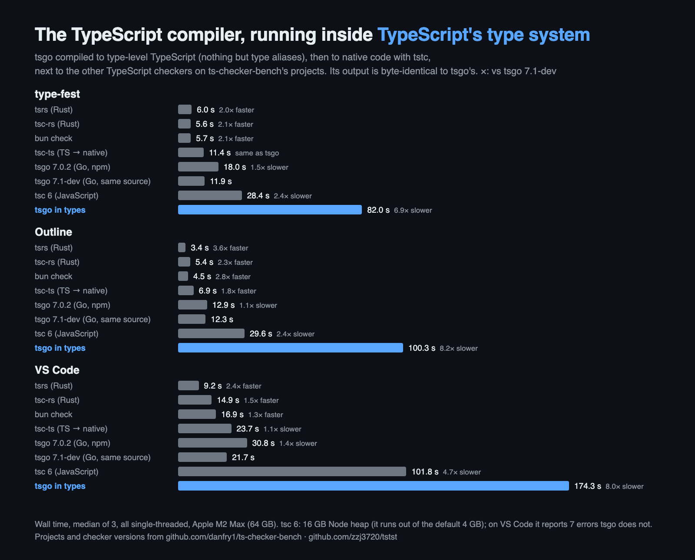

# tstst

**The TypeScript compiler, running inside TypeScript's type system.**

This repository is tsgo — the Go port of the TypeScript compiler
(`microsoft/TypeScript`'s `tsc/` directory) — as *type-level* TypeScript:
programs made only of type aliases, whose meaning is what a type checker
computes for them. Nothing here is anything but TypeScript.

- [`programs/tsc.ts`](programs/tsc.ts) is tsgo's `tsc` command line.
- [`programs/baseline.ts`](programs/baseline.ts) is the driver of tsgo's
  compiler, conformance and transpile test suites.
- [`lib/pure/`](lib/pure) is the runtime they call, itself pure type-level
  TypeScript: 64-bit integers, strings, IEEE floats from bits, a store of
  cells for the heap, maps, panics. It is the semantics: any TypeScript
  checker evaluates it the same way.

A program's entry is `Main<Input>`: give it the input (for `tsc.ts`, the
project's files and arguments) and the type it evaluates to is the output.
tsgo's test suites pass byte for byte this way, and on real projects
`tsc.ts` prints exactly what tsgo prints.



## Real projects

`programs/tsc.ts` checking the projects of
[ts-checker-bench](https://github.com/danfry1/ts-checker-bench) at their pinned
commits, next to every checker ts-checker-bench times and the JavaScript
`tsc` 6. All single-threaded, wall time, median of 3 rounds on one Apple M2
Max (64 GB), 2026-10-27:

| checker | type-fest | Outline | VS Code |
|---|---|---|---|
| tsrs 0.16 (Rust) | 6.0 s | 3.4 s | 9.2 s |
| tsc-rs 0.7 (Rust) | 5.6 s | 5.4 s | 14.9 s |
| bun check 1.4.3 | 5.7 s | 4.5 s | 16.9 s |
| tsc-ts 0.0.3 (TypeScript → native) | 11.4 s | 6.9 s | 23.7 s |
| tsgo 7.0.2 (npm) | 18.0 s | 12.9 s | 30.8 s |
| tsgo 7.1-dev `fed0bf24` (the source of `tsc.ts`) | 11.9 s | 12.3 s | 21.7 s |
| tsc 6.0.3 (JavaScript) | 28.4 s | 29.6 s | 101.8 s |
| **tsgo in the type system** | **82.0 s** | **100.3 s** | **174.3 s** |
| — vs the same tsgo | 6.9× | 8.2× | 8.0× |
| — peak memory (tsgo → type-level) | 6.3 → 21.9 GB | 2.0 → 10.8 GB | 7.3 → 26.0 GB |

- `tsc.ts`'s output is byte for byte that of tsgo built from the same commit
  on all three projects. That tsgo, tsc-rs and tsrs port TypeScript 7.1-dev
  and report 1 error on Outline and 10 on VS Code that tsgo 7.0.2 does not.
- tsc 6 runs with a 16 GB Node heap: with the default 4 GB it crashes on
  type-fest and VS Code. On VS Code it reports 7 errors (implicit `any` in
  tests) that tsgo does not.
- The type-level programs run compiled to native code by tstc (below). Every
  measurement, with its CPU time, peak memory, error count and machine load,
  is in [`bench/2026-10-27-apple-m2-max.tsv`](bench/2026-10-27-apple-m2-max.tsv).

## Test suites

Against `microsoft/TypeScript` at `fed0bf24149f`:

| suite | result |
|---|---|
| compiler baselines | 6890 tests, 34499 / 34499 baselines identical |
| conformance baselines | 5934 tests, 32206 / 32206 baselines identical |
| transpile baselines | 25 tests, 41 / 41 baselines identical |
| fourslash (`internal/fourslash/tests`) | 4143 passed, 415 skipped (as `go test`), 1761 / 1761 baselines |
| `go test` of 64 packages | 1286 passed, 3 failed (tests that start real processes or read files outside the harness) |

## Running it

Any TypeScript checker can evaluate these programs; at this size one with
its recursion limits removed, and slowly. To run them at the speed above,
compile them to native code with tstc, from
[go2types](https://github.com/zzj3720/go2types) — the toolchain that also
generates them from tsgo's Go sources (`gen_programs.sh` there). Check both
repositories out side by side:

```sh
git clone https://github.com/zzj3720/tstst
git clone https://github.com/zzj3720/go2types
cd go2types && (cd tstc && sh scripts/ci.sh)
tstc/tstc build ../tstst/programs/tsc.ts -o tsc --rt tstc/rt -O 1
```

## License

MIT (`LICENSE`). `lib/pure/softfloat.ts` and the parts of the programs
translated from Go's own sources keep Go's BSD-style license (`LICENSE-GO`).
